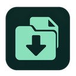

# Moodle Downloader

Moodle Downloader es una app de escritorio para **guardar en tu PC los materiales que tienes disponibles en Moodle**. Puedes descargar una actividad, un curso completo o varios cursos a la vez. La app organiza lo que guarda por curso, sección y actividad para que puedas consultarlo sin conexión cuando el formato lo permita.

[**Descargar MoodleDownloader.exe para Windows x64**](https://github.com/JorgeCodex/MoodleDownloader/releases/latest/download/MoodleDownloader.exe) · [Ver todas las versiones](https://github.com/JorgeCodex/MoodleDownloader/releases)

## Descargar e instalar

1. Usa un equipo con Windows de 64 bits (x64).
2. Abre la página de [Releases](https://github.com/JorgeCodex/MoodleDownloader/releases/latest) y descarga **MoodleDownloader.exe** de la sección **Assets**. Si GitHub solicita acceso, inicia sesión con una cuenta autorizada para este repositorio.
3. Guarda el ejecutable en una carpeta de tu elección y ábrelo. Es portátil y se ejecuta directamente. Para actualizar, descarga el nuevo ejecutable desde Releases.
4. Si la app indica que falta WebView2, instala **Microsoft Edge WebView2 Runtime**. Microsoft ofrece **Evergreen Bootstrapper** para instalación con conexión y **Evergreen Standalone Installer x64** para instalación sin conexión. [Descargar WebView2 Runtime](https://developer.microsoft.com/en-us/microsoft-edge/webview2/#download-section)

## Conectar Moodle y descargar

1. Inicia sesión en tu aula virtual en Edge o Chrome con tu propia cuenta.
2. Presiona **F12** y abre **Aplicación → Almacenamiento → Cookies**. Selecciona el dominio de tu aula, busca la fila **MoodleSession** y copia su **valor**. Trátalo como una credencial y pégalo únicamente en la app.
3. En Moodle Downloader, revisa la dirección HTTPS de tu aula, pega el valor y pulsa **Conectar y ver cursos**. La dirección inicial es la del aula virtual del ITLA y puedes cambiarla.
4. En **Carpeta de descargas**, pulsa **Elegir carpeta** y selecciona dónde guardar los materiales.
5. En **Mis cursos**, abre un curso y usa **Guardar** para descargar una actividad o **Descargar curso** para respaldarlo completo. Para un lote, marca varios cursos y pulsa **Descargar selección**.
6. Abre **Actividad → Registro** para ver los archivos guardados y las incidencias. Si una sesión caduca, vuelve a iniciar sesión en el navegador y copia un valor nuevo de **MoodleSession**.

La app usa la cookie en memoria durante la sesión. Recuerda la dirección del aula y la carpeta de descargas.

## Qué se guarda

| Tipo de contenido | Resultado |
| --- | --- |
| Archivos de Moodle | Los archivos disponibles para tu sesión, con su nombre de descarga cuando Moodle lo proporciona |
| Carpetas | Un ZIP si Moodle lo ofrece o los archivos individuales disponibles |
| Tareas | Instrucciones en HTML y adjuntos visibles de la consigna |
| Páginas, libros y textos de sección | Copias HTML con los adjuntos y medios del aula que se pudieron guardar |
| Cuestionarios | Instrucciones y revisiones de intentos visibles para tu sesión, en HTML imprimible. Puedes convertirlas a PDF con **Imprimir → Guardar como PDF** en el navegador |
| Enlaces, multimedia externa y otros tipos de actividad | Accesos directos o enlaces que se abren en el navegador |

Los enlaces de YouTube, Vimeo, SharePoint y otros servicios externos requieren conexión y pueden pedir una sesión en ese servicio. Los complementos y formatos personalizados de Moodle pueden ofrecer parte del contenido solo como enlace.

## Carpetas, incidencias y reintentos

- Un sufijo como **[m253640]** identifica la actividad en Moodle y evita que dos actividades con el mismo título compartan carpeta.
- Una **incidencia** indica un problema con un archivo, actividad o sección. Busca el motivo concreto en **Actividad → Registro**.
- Puedes cancelar y volver a ejecutar la selección. Los archivos terminados se conservan. La app compara por contenido cuando coinciden los nombres y guarda las versiones distintas con otro nombre.
- Un archivo en curso se escribe como temporal y se publica cuando la transferencia se completa.

## Compilar desde el código fuente

En Windows instala Rust estable con el toolchain MSVC y las herramientas de compilación de C++ de Visual Studio con Windows SDK. El SDK compila el recurso de icono del ejecutable.

~~~powershell
git clone https://github.com/JorgeCodex/MoodleDownloader.git
cd MoodleDownloader
cargo build --release --locked
cargo test --locked
~~~

El binario se genera en **target/release/moodle-downloader.exe**. El motor está en **src/**. La interfaz incluida en el ejecutable está en **ui/** y se muestra mediante WebView2. Los recursos del logo están en **assets/**.
